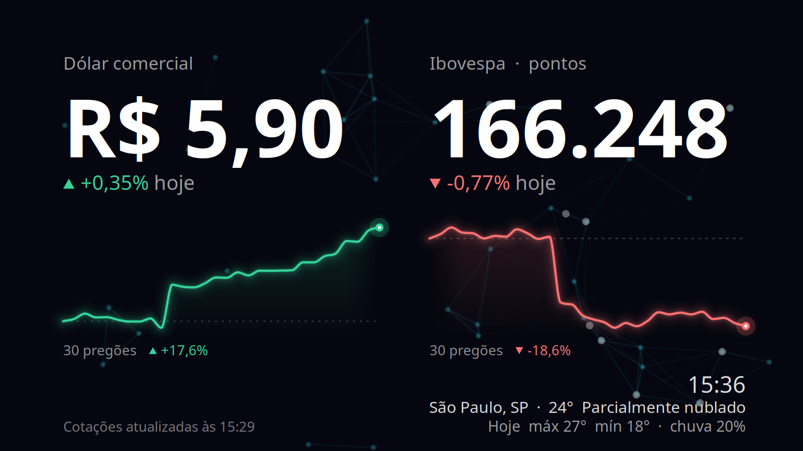

# GCLOUD - Dólar

Um tema para o [xfce4-screensaver](https://docs.xfce.org/apps/xfce4-screensaver/start) que mostra o
dólar, o Ibovespa e a previsão do tempo da sua cidade, sobre uma rede de partículas.

- Dólar e Ibovespa com a variação do dia e o gráfico dos últimos 30 pregões.
- Previsão do tempo da cidade onde você está.
- Leve: cerca de 15% de um núcleo em três monitores. Na bateria, reduz o ritmo sozinho.
- Sem conta e sem chave de API.

## Instalar

Precisa de XFCE com `xfce4-screensaver` em sessão X11.

    # Debian, Ubuntu, Mint
    sudo apt install build-essential pkg-config libgtk-3-dev libgl-dev python3
    # Fedora
    sudo dnf install gcc make pkgconf-pkg-config gtk3-devel mesa-libGL-devel python3

    ./install.sh

Depois escolha "GCLOUD - Dólar" em `xfce4-screensaver-preferences`. Para remover: `./uninstall.sh`.

O instalador pede a senha uma vez, para copiar um único arquivo: o xfce4-screensaver só
executa temas que estejam no diretório de sistema dele. Fora de lá o tema aparece na lista,
mas a tela fica preta. Todo o resto vai para a sua pasta de usuário.

## Como funciona

São dois programas. O **coletor** (`gcloud-dolar-fetch`, Python) busca os dados a cada 30
minutos, por um timer do systemd, e grava em `~/.cache/gcloud-dolar/dolar.ini`. O **tema**
(`gcloud-dolar`, C) só lê esse arquivo e desenha. Ele nunca acessa a rede.

Se uma fonte falhar, vale o último valor salvo. Passadas 3 horas sem atualização, o valor
ganha o aviso "desatualizado" e a previsão do tempo some.

## Cidade

A cidade vem do IP da sua conexão, o que pode errar com VPN. Para fixar:

    mkdir -p ~/.config/gcloud-dolar
    echo "Joinville, SC" > ~/.config/gcloud-dolar/cidade

## Como ler o gráfico

- A linha são os últimos pregões e termina no valor de agora.
- Verde se o período fechou acima de onde começou, vermelha se fechou abaixo. A linha
  pontilhada marca esse ponto de partida.
- A variação "hoje", abaixo do valor, é outra conta e pode ter sinal diferente.
- Mercado parado aparece como linha quase reta: a escala nunca amplia uma oscilação menor
  que 3% do valor.

## Fontes e privacidade

| Dado | Fonte | Reserva |
| --- | --- | --- |
| Dólar | [AwesomeAPI](https://docs.awesomeapi.com.br/api-de-moedas) | [Banco Central (PTAX)](https://dadosabertos.bcb.gov.br/dataset/dolar-americano-usd-todos-os-boletins-diarios) |
| Ibovespa | Yahoo Finance (`^BVSP`) | [HG Brasil](https://hgbrasil.com/status/finance) |
| Localização | [ipapi.co](https://ipapi.co) | [ipwho.is](https://ipwho.is) |
| Previsão do tempo | [Open-Meteo](https://open-meteo.com) | |

São serviços públicos, sem garantia, e o do Yahoo não é oficial. As cotações têm alguns
minutos de atraso: servem para acompanhar, não para operar.

O único dado seu que sai da máquina é o endereço IP, como em qualquer requisição. Fixando a
cidade, os serviços de localização deixam de ser consultados.

## Desempenho

A primeira versão gastava mais de um núcleo inteiro em três monitores. Chegar a 15% levou
quatro rodadas, sempre medindo antes de mexer:

| Etapa | CPU (de um núcleo) |
| --- | --- |
| Primeira versão: tudo redesenhado 30 vezes por segundo | 113% |
| Painel guardado em cache; rede de partículas rasterizada pelo próprio tema | 60% |
| Animação medida em tempo, memória reaproveitada entre quadros | 43% |
| Desenho por OpenGL | 15% |

Medido num Core i5-1335U com três monitores e o compositor do xfwm4 ligado.

A surpresa foi onde estava o custo. O tema em si sempre gastou pouco; quem sofria era o
servidor X, compondo cada quadro. Com OpenGL esse trabalho vai para a placa de vídeo. O
preço é memória: uns 90 MB por monitor, contra 32 MB do desenho por GTK e cairo, que
continua no programa como reserva para quando não houver OpenGL.

Na tomada o tema roda a 30 quadros por segundo; com a bateria descarregando, cai para 10,
o que corta o consumo para menos da metade.

Três ideias foram testadas e descartadas por não se pagarem: repintar só os trechos da tela
que mudam, sincronizar os quadros entre monitores e trocar o GTK por Xlib puro.

## Cuidados

O tema lê um arquivo que pode estar corrompido e passa horas rodando, então duas coisas
foram verificadas a sério: entrada ruim e memória.

- **Entrada ruim.** `make check` roda o tema 52 vezes sob AddressSanitizer e UBSan, com
  arquivos vazios, truncados, com `nan`, `inf`, textos enormes e datas absurdas, em quatro
  tamanhos de tela. Nenhum acesso inválido. Valores fora do razoável são ignorados em vez
  de quebrar o desenho.
- **Memória.** Rodando com o arquivo trocado a cada segundo, o uso não cresce. Sobra uma
  alocação de cerca de 1 KB, feita uma vez pelas bibliotecas de fontes.
- **Coletor.** Confere a faixa dos valores antes de gravar e troca o arquivo de uma vez,
  para o tema nunca ler pela metade.
- **Encerramento.** O tema sai limpo quando o screensaver o encerra.

O que ainda não foi testado: outras distribuições, placas de vídeo que não sejam Intel e a
troca para bateria num notebook de verdade fora da tomada (só simulada).

## Testar

    ~/.local/bin/gcloud-dolar                     # abre numa janela
    ~/.local/bin/gcloud-dolar --snapshot t.png    # grava um quadro
    ~/.local/bin/gcloud-dolar-fetch               # coleta agora
    journalctl --user -u gcloud-dolar.service     # histórico das coletas
    make check                                    # bateria de testes de memória

| Variável | Efeito |
| --- | --- |
| `GCLOUD_DOLAR_CACHE` | outro arquivo de dados |
| `GCLOUD_DOLAR_FPS` | quadros por segundo fixos |
| `GCLOUD_DOLAR_RENDER` | `gl` ou `gtk`, para forçar um dos desenhos |
| `GCLOUD_DOLAR_POWER_DIR` | diretório no lugar de `/sys/class/power_supply`, para simular bateria |

## Personalizar

No topo de `gcloud-dolar.c` ficam as cores (`BG_*`, `AC_*`, `UP_*`, `DN_*`), o prazo de
desatualização (`STALE_SECONDS`) e os quadros por segundo (`FPS_AC`, `FPS_BATTERY`). Depois
de mudar, rode `./install.sh` de novo. O intervalo de coleta está em
`systemd/gcloud-dolar.timer`.

## Limitações

- Só X11. No Wayland o xfce4-screensaver embute os temas de outro jeito, ainda não suportado.
- A previsão é só a do dia.

## Licença

[GPL-3.0-or-later](LICENSE). Copyright (C) 2026 Juliano Liberato.
